# TrueNAS dataset and share access

To give someone access on TrueNAS Community Edition 25.10, grant rights in
the dataset's filesystem access control list (ACL). A share makes the files
reachable. An NFS mapping changes which account TrueNAS checks. Neither
replaces the ACL. This model applies in the web interface and through the API.

## What must you configure?

| Setting | Question | Required or optional? |
| --- | --- | --- |
| File permissions | What can this account do? | **Required for access.** Keep existing permissions if they already allow the operation. The `filesystem_acl` block is optional and manages the ACL through OpenTofu. |
| Owner | Who owns this file or folder? | **No change needed to grant access.** Give the account rights instead of making it the owner. |
| SMB sign-in | Who is connecting? | **Required for named SMB access.** The account needs file permissions. If a share ACL restricts access, it must allow the request too. |
| `maproot_user` | Should only client `root` use a different account? | **Optional.** Required if you set `maproot_group`. |
| `mapall_user` | Should everyone using this export act as one account? | **Optional.** Required if you set `mapall_group`. Choose it instead of `maproot_user`, not alongside it. |

## Follow a request to the file

File permissions are required. NFS mapping is optional. The owner doesn't
need to change. [Archify source](assets/truenas-access.workflow.json).

| Client | Which identity does TrueNAS check? |
| --- | --- |
| SMB from Windows or Linux | The signed-in SMB account. No NFS mapping applies. |
| NFS with `SYS` and no mapping | The client's numeric user and group IDs. Manage matching IDs for non-root accounts. TrueNAS treats client `root` as anonymous by default. |
| NFS with `maproot_user` | The mapped account, but only when the program opening the file runs as client `root`. Who mounted the share doesn't matter. |
| NFS with `mapall_user` | One service account for all requests on the export. Use it only when clients should act as one account. |

`maproot_group` and `mapall_group` are optional. Each requires its matching
user field. Set the group if the ACL grant relies on it. With `SYS`, use
trusted clients. An NFS host allowlist doesn't authenticate individual users.
If you need per-user authentication, assess Kerberos.

Grant rights to the resulting account, directly or through a group. For NFSv4
ACLs, the `READ` preset includes directory traversal and `MODIFY` includes
deletion. Opening a nested file still requires traversal on every parent
directory. Changing inheritance flags alone doesn't update existing children.

`hosts` and `networks` limit NFS clients. A read-only export blocks writes but
still requires file read permission. SMB share ACLs don't apply to NFS.
SMB `browsable` controls listing, not access or NAS discovery. If discovery
fails on Linux, use `smb://NAS_HOST/SHARE`.

## Choose an identity

- **Person:** use one named SMB account across devices. A person who needs one
  share uses the same kind of account, with only the necessary grants.
- **Group:** use a group when membership should change without editing ACLs.
  Reuse it where the same members should keep access. Create another group
  when access must change independently. A primary group such as `smb-users`
  needn't grant dataset access. A direct user entry also works for an exception.
- **Service:** use a non-root account for workloads with the same rights and
  revocation needs. Use separate accounts if access or activity must be tracked
  independently. Don't share a service account with a person.
- **Provisioning:** grant a dedicated API identity storage management rights,
  not membership in file access groups.

Use separate datasets when ownership, audience, or snapshot and restore
policies differ.
Use folders when those policies match. Two shares to the same files don't
isolate them.

## Choose who owns the dataset

The dataset owner is the owner of its root directory, not the API caller or
share user. Check the actual owner and group in **Datasets > Permissions**,
especially after import. TrueNAS can apply an
initial ACL based on the parent and preset.

`owner@` and `group@` refer to the owner and owning group of the file or
directory being checked. If `root` owns the dataset and Alex owns a file in
it, `owner@` refers to Alex on that file. It doesn't change ownership.
A named ACL entry refers to a specific account or group.

Keep the system owner for shared datasets. Give readers and editors ACL
entries instead of ownership. If an application requires different ownership,
verify the requirement first. A recursive ownership change also affects
existing files.

## Examples

| Dataset | Access policy | What to test |
| --- | --- | --- |
| Documents and media | Reuse `household-editors` if both datasets have the same editors. Add `documents-readers` only if needed. | A documents-only reader can't edit documents or open media. |
| Private files | Keep the same SMB accounts. Grant access through a separate group if it must change independently. | A user with household access alone can't open a file in the private share. |
| Backups | Restrict NFS to the backup client. Use `mapall` if all requests should use its service account. Split datasets and accounts for isolated repositories. | The job can write and read back a file, but can't open other repositories. |
| Image library | SMB publishers get `MODIFY`. The reader account gets `READ`, over SMB or through a read-only NFS export. | The publisher can write. The reader can open a nested image but can't write. |
| Application data | Give the app's non-root account only the rights it needs. Omit shares for local-only storage. | The app can use its data without access to unrelated datasets. |

## Verify access

Get the NAS owner's approval before contacting TrueNAS. After configuration, check the
owner, group, and ACL. Inspect an existing child file if inheritance matters.
Test one allowed operation and one denied operation with the actual client
account. A successful plan doesn't prove file access.

Use the [SMB](runbooks/truenas-share-smb.md), [NFS](runbooks/truenas-share-nfs.md),
or [multiprotocol](runbooks/truenas-share-multiprotocol.md) runbook to deploy.
For Proxmox image storage and Home Assistant backups, see
[ISO library](runbooks/truenas-proxmox-iso-library.md) and
[Home Assistant backups](runbooks/truenas-home-assistant-backups.md).
See [Set dataset permissions](runbooks/truenas-dataset-permissions.md) or
[Diagnose TrueNAS share access](runbooks/diagnose-truenas-share-access.md)
when the ACL or effective identity needs review.

Sources for TrueNAS 25.10: [NFS mappings](https://www.truenas.com/docs/scale/25.10/scaletutorials/shares/addingnfsshares/),
[multiprotocol shares](https://www.truenas.com/docs/scale/25.10/scaletutorials/shares/mixedmodeshares/),
[dataset creation](https://github.com/truenas/middleware/blob/TS-25.10.0/src/middlewared/middlewared/plugins/pool_/dataset.py#L633-L661),
and [filesystem ACL API](https://api.truenas.com/v25.10/api_methods_filesystem.setacl.html).
